# Ziggurat

**A tiered team of Claude Code agents that builds software on its own, inside a sandbox, and can only ship what passes checks it cannot touch.**

> Status: **experimental.** This is a working setup extracted from real use, published early. Expect sharp edges, Proxmox-specific plumbing and breaking changes.

  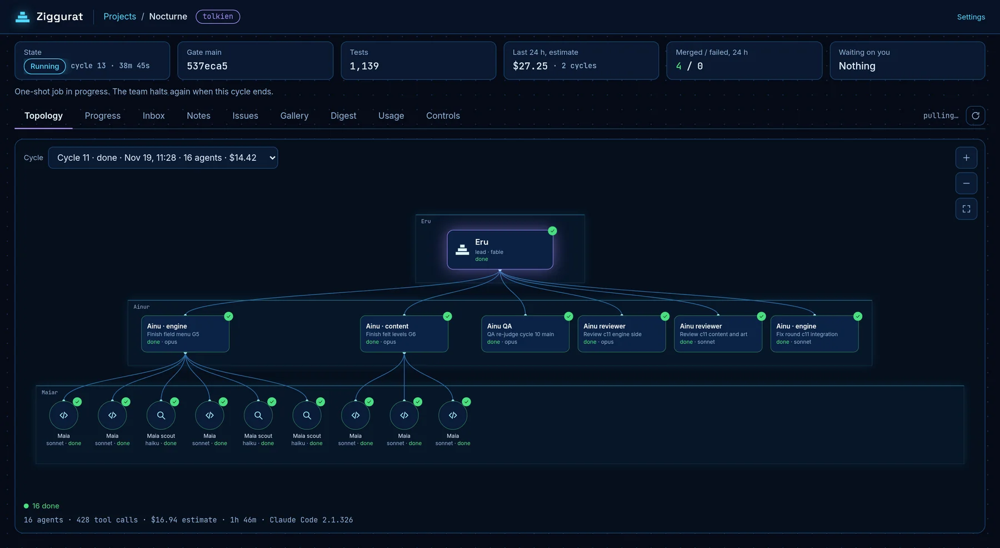

<em>One finished cycle of the example project, a PlayStation 1 JRPG: the lead, six area leads, nine builders and scouts. 16 agents, 428 tool calls, 1 h 46 min, nobody watching.</em>

## Contents

- [The idea](#the-idea)
- [How it works](#how-it-works): [the team](#the-team) · [a cycle](#a-cycle) · [the gate](#the-gate) · [the sandbox](#the-sandbox)
- [The console](#the-console)
- [Staying in charge](#staying-in-charge)
- [Creating a project](#creating-a-project)
- [What protects what](#what-protects-what)
- [Results so far](#results-so-far)
- [What's in here](#whats-in-here)
- [Requirements and getting started](#requirements-and-getting-started)
- [Limits you should know](#limits-you-should-know)

## The idea

Most "autonomous coding" failures come from one thing: **the agent that did the work also decides it is done.** Ziggurat separates those roles mechanically, then lets the team run for hours without you.

- **A gate the agents cannot edit.** Work reaches `main` only when a root-owned script, running as a separate unprivileged user on a fresh checkout, says every check passes. The number of passing tests may not drop. The project defines its checks; the agents cannot change them.
- **A tiered team, priced by thinking.** The lead (top model) plans and reviews lightly. Area leads (Opus) own one goal each, break it into steps and review every diff. Builders (Sonnet) and scouts (Haiku) do the long, token-heavy work in short sessions.
- **A sandbox with one door.** Each project runs in its own VM with no route anywhere. The only way out is a proxy that allows a short list of domains. The VM holds no credentials that work anywhere else.
- **Fresh sessions, durable notes.** No agent keeps a long context. The lead starts every cycle from its own handoff file and the gate's verdicts, and rewrites that file before it ends.
- **An owner who is not in the loop, but is in charge.** You write the goal. After that you can watch, send a note, mark up a screenshot, ask for one job, or stop the team, from one page. The team never waits for you.

## How it works

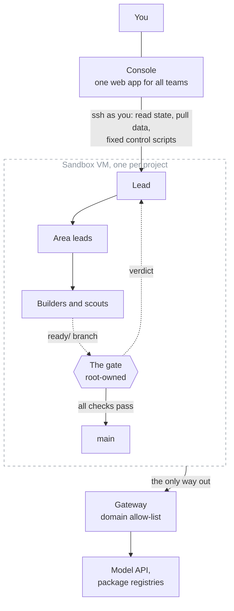

Nothing on a VM can reach your side. The console connects to the VM as you; the VM never connects back.

### The team

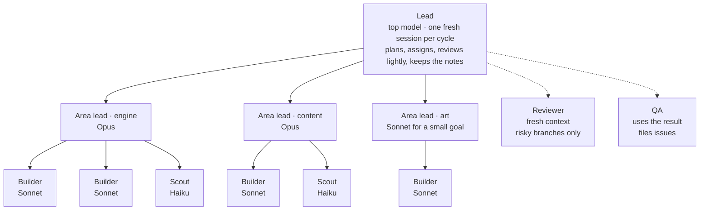

| Role | Does | Never does |
|---|---|---|
| **Lead** | Picks 1 to 3 goals per cycle, briefs one area lead per goal, reads their reports, submits good branches, writes `STATE.md` and the journal | Writes code |
| **Area lead** | Owns one goal in its own git worktree: plans the steps, hands each to a builder, reviews every diff, commits, runs the final checks | Lets a builder commit |
| **Builder** | Implements one step, test first, and reports | Commits, touches files outside its brief |
| **Scout** | Searches, runs checks, summarizes long output | Edits files |
| **Reviewer** | Reviews one risky branch with no knowledge of the author's reasoning | Edits |
| **QA** | Uses the result the way its user would and files honest issues | Fixes what it finds |

Agent ids are neutral and stable (`area-lead-engine`, `builder`, `scout`, `reviewer`, `qa`). A **theme** only changes the names people and prompts see, never the behaviour:

| Role | plain | tolkien | starship | orchestra | borg |
|---|---|---|---|---|---|
| lead | lead | Eru | Captain | Conductor | Queen |
| area lead | area lead | Ainu | Chief Officer | Section Principal | Unimatrix |
| builder | builder | Maia | Crew member | Player | Drone |

Eleven themes ship in [`themes/`](themes). The screenshots here use `tolkien`.

### A cycle

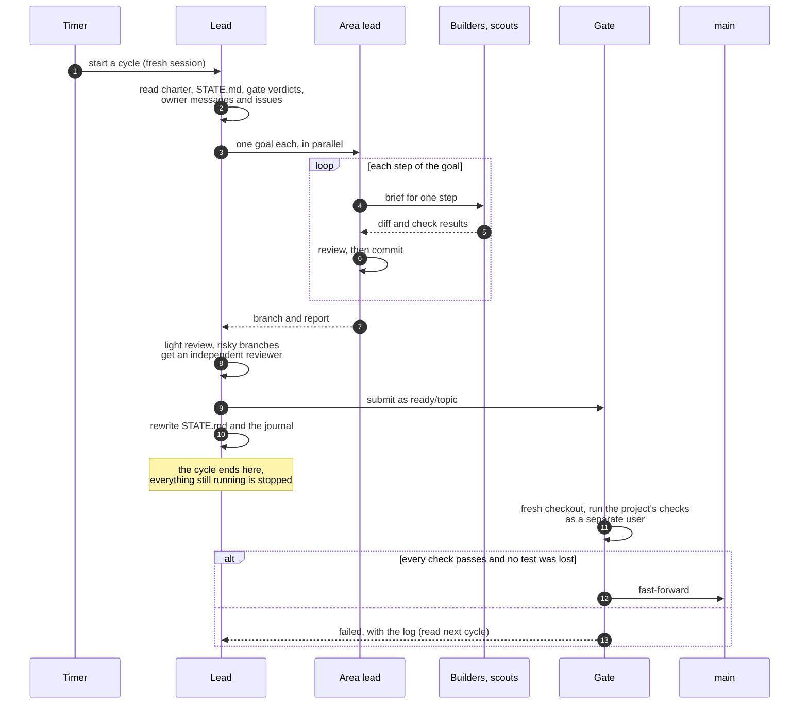

The next cycle starts 15 minutes after the last one ended, until a daily cap, a budget, a usage limit or you say stop. A cycle that only hit a usage limit does not count against the cap, so the team picks up again by itself when the limit lifts.

### The gate

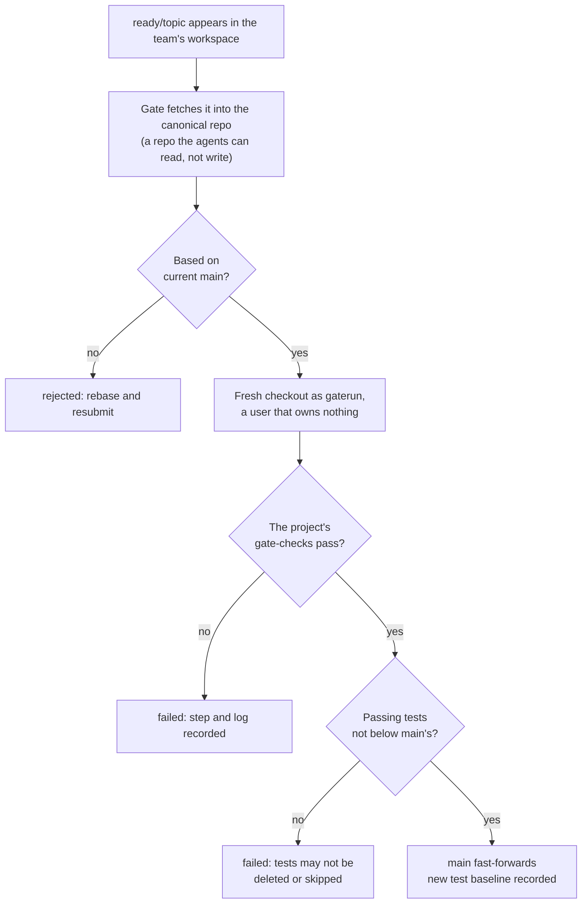

Three users keep the team away from the definition of done:

- `agent` runs Claude Code and owns the workspace. No sudo.
- `gatekeeper` owns the canonical repository and does the gate's git work. It never runs agent-written code.
- `gaterun` runs the candidate's code during checks and owns nothing that matters.

What "done" means is one script per project, `gate-checks`, installed root-owned. In the [examples](examples) that is a type check, unit tests, a build, a headless boot with random input and a scripted playthrough for a browser game; host tests, a console build and a playthrough in a headless emulator for the PS1 game; `ruff` and `pytest` on a fresh virtualenv for the Python starter.

Before a new team is ever started, a **gate proof** runs the real gate twice: a harmless change must be merged, and a change that deletes a test file must be refused.

### The sandbox

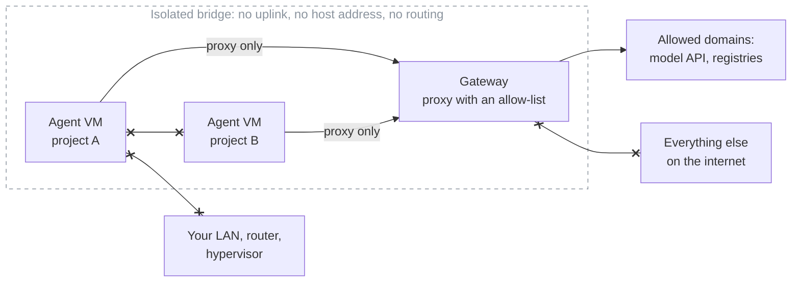

- The VM has **no default route**. The gateway does not forward packets; it only proxies requests to listed domains.
- VMs on the same bridge are blocked from each other by root-owned firewall rules inside each VM.
- A **wall check** runs inside every new VM, as the agent user, before it is used: the LAN, the router, the hypervisor, the open internet, other agent VMs and non-listed domains must all be out of reach, and the listed ones must work. Only then is the VM snapshotted.
- Inside the VM, agents run with permission prompts off. The VM, the allow-list and the absence of credentials are the safety boundary, not the prompts.

## The console

One web app for all your teams. It runs on your workstation, reaches each VM over ssh as you, and changes things on a VM only through fixed, root-owned scripts with checked arguments.

**Click any agent to see what it was asked and what it answered.** Model, context size, tokens, cost estimate, time, its brief from the tier above, the tools it used, and its final report.

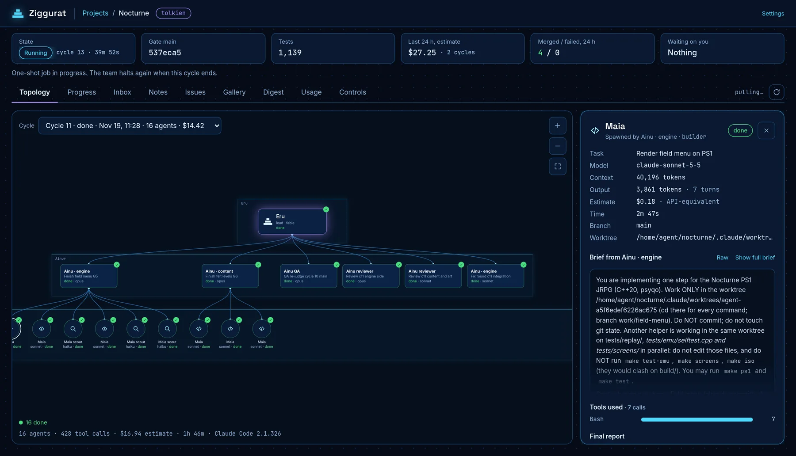

**Progress.** Cost and length of every cycle, and the number of tests on `main` each time the gate merged. Here the count climbs to 1,139 across 13 cycles.

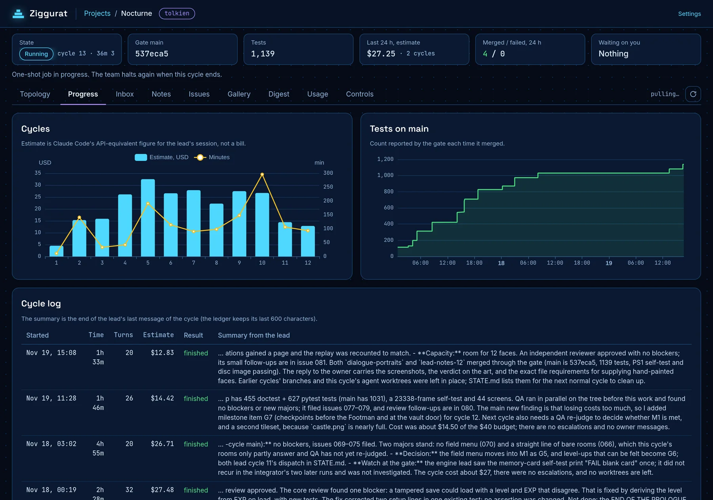

**Gallery.** Screenshots the gate took of the newest build that passed, by day, so you can see the product without opening it.

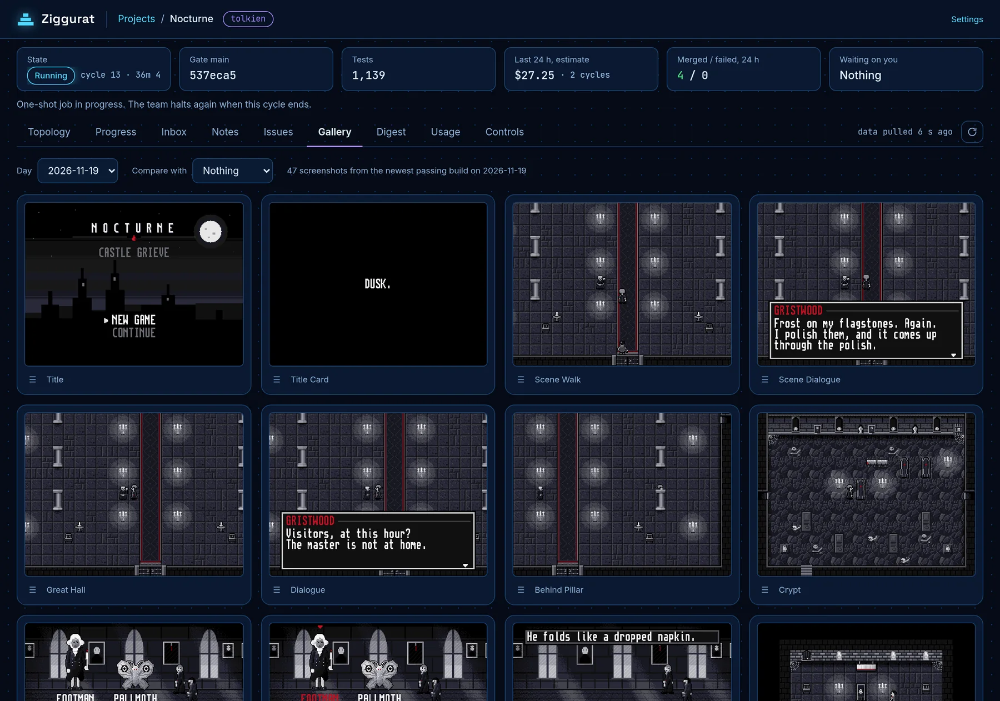

**Usage.** Tokens and cost estimates by model, by role and by cycle, computed from the transcripts. This is where the tiering shows up.

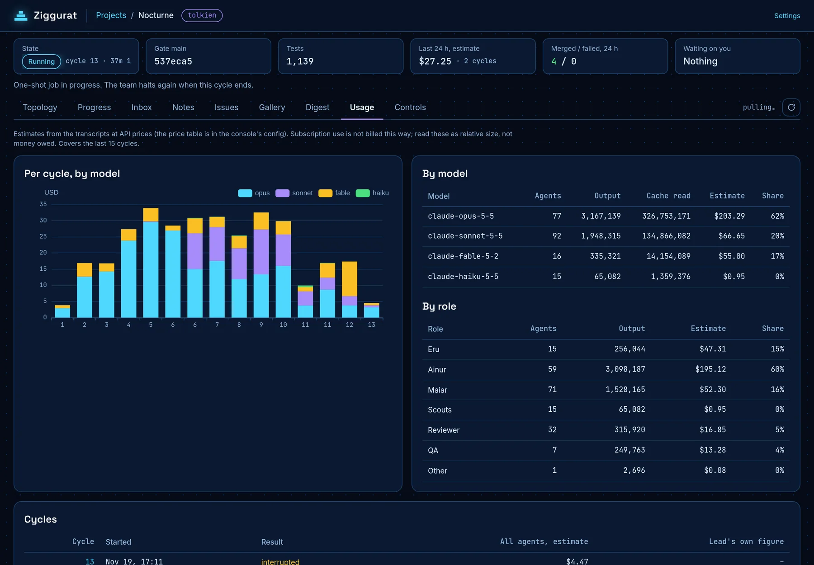

Also: **Notes** (the lead's plan, its journal, QA's issues), **Briefs** (a short summary of every finished cycle, with a spoken version) and **Settings** (projects and deploy targets). See [console/README.md](console/README.md).

## Staying in charge

The team runs without you. These are the ways to steer it, from lightest to heaviest. None of them needs a terminal.

**Write to the lead.** A message lands in a root-owned inbox on the VM that the agents cannot write to, which is what makes it genuine. The lead answers every message `done`, `planned` or `declined`, and can ask you a question with the default it will take if you do not answer.

| Tier | When the lead sees it | What it is told |
|---|---|---|
| note | Start of the next cycle | Weigh it in planning |
| priority | Mid-cycle, once | Finish what is running, then plan it in |
| urgent | At once | Handle it before new work; working agents are asked to reach a safe point |

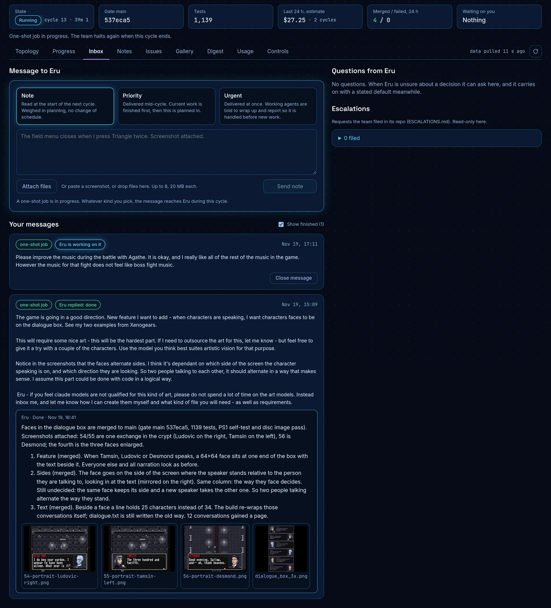

<em>A feature request and the lead's answer two and a half hours later: merged, with screenshots. (The reply is shortened here.)</em>

**Point at it.** From any gallery screenshot, draw a box, an ellipse or a freehand mark and raise an issue. The lead triages it, and the Issues board follows it from new to done, with a before and after.

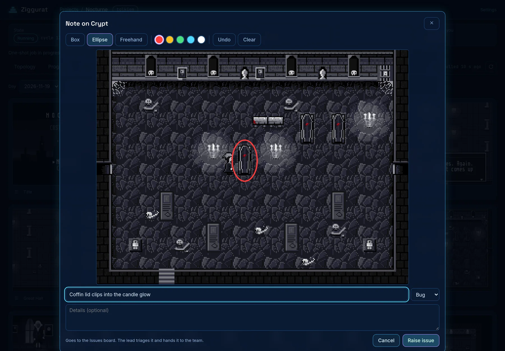

**Ask for one job.** A one-shot job runs a single cycle for the work you describe, then puts the team back as it was: a halted team halts again, a team between cycles (or at its daily cap) runs on. Good for feedback and fixes you want now, without letting the team run on or waiting for the next cycle.

**Stop it.** Now, after the cycle in progress, or at a set time:

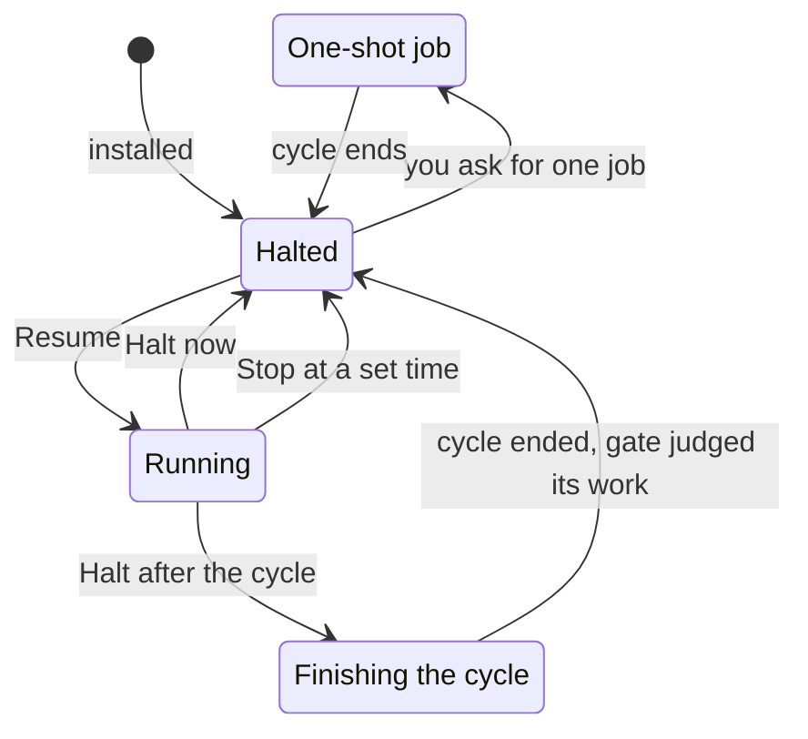

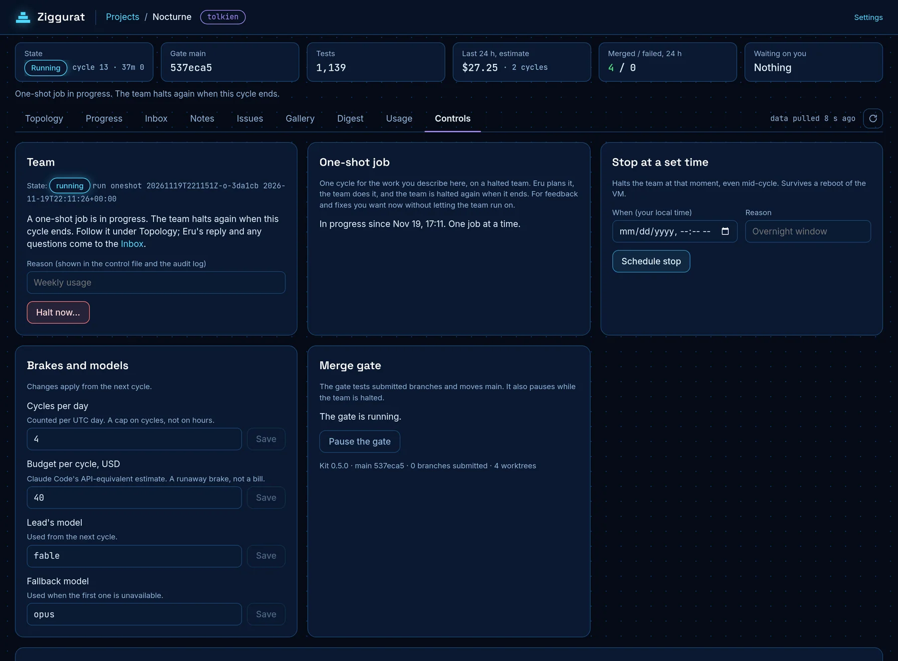

The brakes are on the same page: cycles per day, a budget per cycle, the lead's model and its fallback. Every change the console makes is in an audit log.

## Creating a project

With deploy targets turned on, the console makes the sandbox for you. Two clicks, about five minutes, and the result is a team that is installed, signed in, proven and **halted**. Starting it is always your decision.

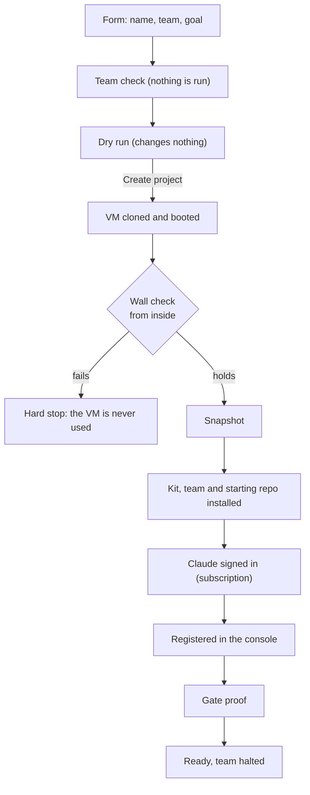

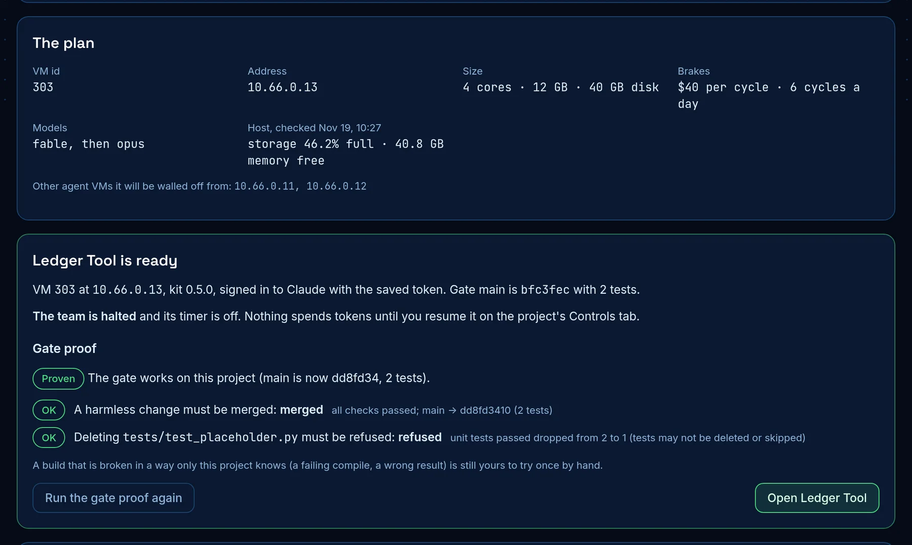

What the console will not do: destroy or roll back a VM, touch an id outside the target's range or on your protected list, touch an id that is already in use, run two deploys at once, or start a team. After a failure it shows how far the run got and the exact commands to clean up by hand.

The same steps work without the console: [`sandbox/proxmox`](sandbox/proxmox) creates the VM and [`sandbox/install`](sandbox/install) installs a team in it. See [Getting started](docs/getting-started.md).

## What protects what

| Risk | What stands in the way |
|---|---|
| The team declares unfinished work done | The gate: root-owned checks on a fresh checkout, as another user; the passing-test count may not drop |
| The team weakens the checks | `gate-checks` and the gate are root-owned; the team can only propose a check and ask you to promote it |
| An agent reaches your network or the internet | No route out of the VM; a proxy with a short domain list; proven from inside before first use |
| One project's team reaches another's | Firewall rules inside each VM, read back as root before the snapshot |
| Stolen credentials | The VM holds none that work elsewhere. Sign-in is a subscription login or one stored token; an API key is refused |
| A forged "message from the owner" | Owner messages live where agents cannot write; a notice mid-cycle never carries the message text |
| The console is tricked into running something | Every change on a VM is one fixed script with checked arguments; every saved value is validated field by field; requests from another site are refused |
| Runaway spend | Budget per cycle, cycles per day, stop at a set time, halt. Usage limits of your subscription still apply on top |
| A new team that was set up wrong | Gate proof before anyone can start it; the team is always left halted |

Every allow-listed domain is also a possible way to send data out. Keep the list short. Read [sandbox/proxmox/README.md](sandbox/proxmox/README.md) before running anything.

## Results so far

The example project in the screenshots is a PlayStation 1 JRPG in C++20, built almost entirely by its team: engine, content, pixel art, music, tests and a playthrough that runs in a headless emulator on every submission.

A tiering trial on that project (costs are Claude Code's API-equivalent estimates of subscription use, not bills):

| | Opus does everything | Tiered team |
|---|---|---|
| Cost per merged goal | $12.72 | **$7.85** |
| Share of spend: Opus / Sonnet / Haiku / lead | 87% / 0.2% / 0% / 13% | 56% / 33% / 1% / 10% |

About 38% cheaper per goal, with the independent reviewer and QA still on. Two runs is a small sample, and a "goal" varies in size: measure on your own project. Details in [docs/results.md](docs/results.md); what went wrong along the way in [docs/lessons.md](docs/lessons.md).

## What's in here

| Path | What |
|---|---|
| [`kit/vm/`](kit/vm) | Installed inside each sandbox VM: the cycle runner, the gate and its proof, the owner inbox and issues, one-shot jobs, halt and resume, sign-in, status commands, systemd timers. Tested with `bash kit/vm/tests/run.sh` |
| [`sandbox/proxmox/`](sandbox/proxmox) | Ansible for the isolated network, the proxy gateway and one VM per project, with the wall check |
| [`sandbox/install/`](sandbox/install) | Ansible that installs the kit and a team in a fresh sandbox VM |
| [`console/`](console) | The web app: projects, topology, progress, inbox, issues, gallery, usage, controls, settings, and creating a project |
| [`examples/python-starter/`](examples/python-starter) | A generic team with a venv/ruff/pytest gate and a starting repo that passes it. You write the goal |
| [`examples/web-game/`](examples/web-game) | A TypeScript browser game: charter, gate checks (type check, unit tests, headless boot and fuzz, smoke playthrough), team |
| [`examples/ps1-cpp/`](examples/ps1-cpp) | A PlayStation 1 game in C++20: charter, gate checks (host tests, console build, emulator playthrough, disc image), toolchain recipe, team |
| [`themes/`](themes) | Display names for the roles. Behaviour never changes with a theme |
| [`tools/render-team.py`](tools/render-team.py) | Renders a team folder for a theme |
| [`workstation/`](workstation) | A brief for every finished cycle, with a spoken version |
| [`docs/`](docs) | [Architecture](docs/architecture.md) · [Getting started](docs/getting-started.md) · [Lessons](docs/lessons.md) · [Results](docs/results.md) · [Roadmap](docs/roadmap.md) |

A project is described by one folder, the **team bundle**: `CHARTER.md` (the goal and the boundaries, written by you), `GATE-CONTRACT.md`, `gate-checks`, the lead's prompt and `agents/*.md`. The examples are bundles.

## Requirements and getting started

- A **Claude subscription**. The agents sign in with it; API keys are never used.
- A **Proxmox VE** host for the sandboxes (other backends are on the roadmap) and Ansible on your workstation.
- Docker for the console.

1. Set up the sandbox network and the gateway once: [`sandbox/proxmox`](sandbox/proxmox/README.md).
2. Start the console: [`console/README.md`](console/README.md).
3. Create a project from the console, or by hand with the two playbooks: [Getting started](docs/getting-started.md).
4. Read the first cycle's transcript, the ledger and the gate verdicts before you let it run on.

## Limits you should know

- **Experimental.** Interfaces change. The kit can be upgraded on a running VM, but read the notes first.
- **Proxmox only** today. The gate and the kit do not care where the VM runs; the sandbox playbooks do.
- **Starting a brand-new project still needs a team bundle.** The console deploys one; it does not yet help you write one for a new stack ([#10](https://github.com/awall451/ziggurat/issues/10)).
- **The gate is only as good as its checks.** A count of passing tests can rise while a test gets looser. Protect the checks that matter by name.
- **Subscription usage is shared** between the teams and your own Claude use. Cycles wait out a limit and continue; watch your usage the first days.
- **The topology is read from Claude Code's transcripts**, an internal format that can change between versions. The parser skips what it does not understand.
- **The console has no login of its own.** Keep it on a private network or behind an auth proxy.

## License

MIT, see [LICENSE](LICENSE).
